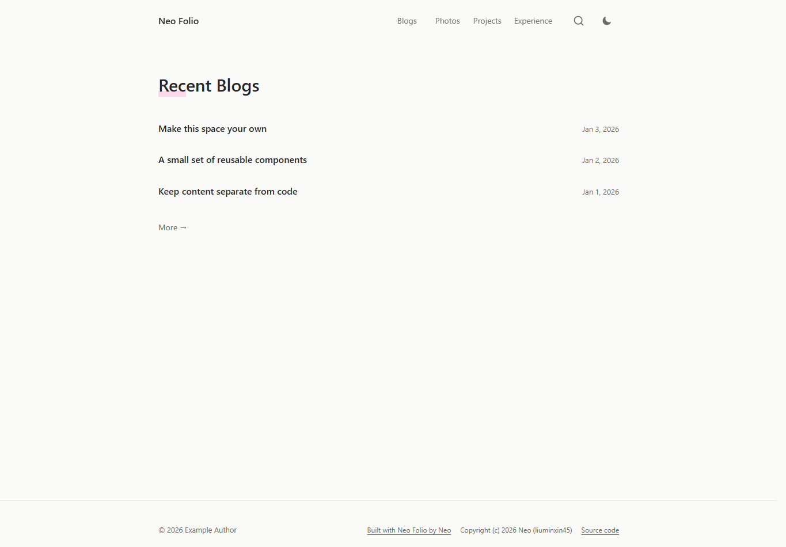

# Neo Folio

一个简洁的 React 网站模板，包含博客、作品目录、图库和经历页面。界面与数据分开维护，默认不需要账号、数据库或外部 API。

[查看在线演示](https://liuminxin45.github.io/neo-folio/) · [组件说明](docs/components.md) · [架构说明](docs/architecture.md) · [署名与许可](docs/licensing.md)



Neo Folio is an editorial React personal-site template with blogs, a project directory, photography, and experience pages. It uses CPAL-1.0 and includes synthetic example content.

## 适合怎样的网站

适合以文章、作品和照片为主的个人网站。默认内容来自仓库中的类型化数据和 TSX 正文，不依赖数据库或在线 CMS；上线前需要替换身份信息与虚构示例。

需要账号、后台或 AI 服务时，要自行实现相应服务和访问控制。公开部署还需遵守 CPAL-1.0 的显著署名及相关源码提供要求，不能将本模板按 MIT 模板使用。

## 功能

- 首页只展示最多五篇最新博客，完整内容放在独立目录。
- 浅色、深色和系统主题，支持减少动态效果。
- 页面按需加载，导航立即开始动效；目录标题常驻，正文就绪后淡入。
- 首次绘制后并发预热目录代码，鼠标悬浮和键盘聚焦时也会预热。
- 文章阅读进度、活动章节目录、锚点和历史导航。
- 本地标题与摘要搜索，支持 Ctrl/Cmd + K。
- 图库按需加载、图片预览、Escape 关闭和焦点恢复。
- 透明图标按钮、44px 操作区域和键盘焦点反馈。

技术栈：React 19、TypeScript、Vite、React Router、Tailwind CSS 3 和 Lucide。组件源码随仓库提供，不依赖作者的其他项目。

## 本地运行

需要 Node.js 24+ 和 pnpm 11。仓库锁定了 pnpm 版本，Node 版本见 [.node-version](.node-version)。

如果尚未安装 pnpm：

```sh
npm install --global pnpm@11.25.0
```

下载并启动：

```sh
git clone https://github.com/liuminxin45/neo-folio.git
cd neo-folio
pnpm install --frozen-lockfile
pnpm dev
```

打开终端显示的开发地址。检查、构建和预览：

```sh
pnpm lint
pnpm test
pnpm build
pnpm check:privacy
pnpm preview
```

## 换成你的网站

| 目标 | 修改位置 |
| --- | --- |
| 网站名称、作者、对应源码地址 | [src/config/site.ts](src/config/site.ts) |
| 首屏标题、描述、图标 | [index.html](index.html)、[public/favicon.svg](public/favicon.svg) |
| 文章标题、日期、摘要 | [src/data/posts.ts](src/data/posts.ts) |
| 文章章节和正文 | [src/content/articles.tsx](src/content/articles.tsx) |
| 项目与首次收录时间 | [src/data/works.ts](src/data/works.ts) |
| 经历 | [src/data/experience.ts](src/data/experience.ts) |
| 图片清单 | [src/data/photos.ts](src/data/photos.ts) |
| 图片文件 | [public/images](public/images) |
| 颜色、排版和布局 | [src/index.css](src/index.css)、[src/redesign.css](src/redesign.css)、[src/template.css](src/template.css) |

新增文章时，在 posts.ts 中添加唯一 slug，在 articles.tsx 中添加同名章节数组。章节 id 应唯一且稳定。项目按 listedAt 排序，该日期表示首次收录时间。

正文为受信任的 TSX 节点。搜索只检索标题和摘要。若改为读取外部 HTML 或 Markdown，需要自行加入输入验证和内容清洗。

## 发布演示或自己的网站

仓库包含 [GitHub Pages 工作流](.github/workflows/pages.yml)。在 GitHub 的 Settings → Pages 中，把 Source 设为 GitHub Actions，推送 main 后会检查并发布 dist。

工作流根据仓库名生成子路径，Fork 后无需保留 neo-folio 这个仓库名。源码没有绑定原站服务，也不需要设置部署密钥。工作流通过 GitHub 提供的临时授权发布页面。

本地构建默认使用根路径。手动部署到子路径时，通过 SITE_BASE 设置前缀，例如在 POSIX shell 中运行：

```sh
SITE_BASE=/my-site/ pnpm build
```

PowerShell 对应写法：

```powershell
$env:SITE_BASE = '/my-site/'
pnpm build
Remove-Item Env:SITE_BASE
```

构建会为已知目录和文章生成静态入口文件，GitHub Pages 可直接打开文章链接。新增目录路由时，同时更新 [scripts/finalize-build.mjs](scripts/finalize-build.mjs) 的路由清单。部署到其他 SPA 平台，也可以配置回退到 index.html。

## 架构

```text
src/
  components/   通用界面、加载状态和阅读组件
  hooks/        动态偏好与活动标题跟踪
  lib/          路由预热、资源路径和日期处理
  sections/     导航和页脚
  pages/        首页、目录页、文章页
  config/       网站身份与模板署名
  data/         公开示例元数据
  content/      按需加载的示例正文
public/         示例图片与图标
scripts/        构建收尾、回归测试和隐私检查
docs/           架构、组件、许可与内容边界
.github/        此模板自己的验证与演示部署
```

## 内容边界

文章、项目和经历均为虚构示例，图片是新绘制的几何图形。仓库不包含原网站文章、照片、简历、二维码、联系方式、备案信息、搜索索引、私有服务、部署凭证或原始 Git 历史。

仓库地址、Neo 署名和演示地址是主动公开的来源信息。GitHub Pages 工作流仅属于本模板，与原网站部署无关。

后台、私有简历、访问统计、在线助手和具体项目应用不在模板中。接入自己的服务时，在服务端保存凭证并实现访问控制。不要把私人数据放进浏览器代码或 public 目录。

check:privacy 检查源码和构建输出中的凭证格式、非示例邮箱、私有地址与禁入文件。它不能判断所有文本和图像的隐私，公开前仍需人工检查。详见 [内容边界](docs/privacy.md)。

## 许可与来源声明

本项目使用 **[CPAL-1.0](LICENSE)**，第三方依赖保留各自许可证。

使用模板公开运行网站时，须按 LICENSE 第 14 条及附件 B 显著展示作者署名与来源 URL。默认页脚已经包含：

> Built with Neo Folio by Neo
>
> Copyright (c) 2026 Neo (liuminxin45)
>
> https://github.com/liuminxin45/neo-folio

你可以调整展示样式，但应保持符合许可证的显著署名；不要只写入 HTML 注释或隐藏元素。CPAL 不要求一定放在页脚，默认页脚是本模板提供的实现。

CPAL 第 15 条还对公开网络部署提出相关源码提供要求。修改后部署时，请将 site.sourceUrl 指向你部署版本的对应源码，并履行完整许可义务。你的独立文章、照片和其他可分离内容不会仅因使用模板就自动受 CPAL 约束。详见 [署名与许可](docs/licensing.md)。
